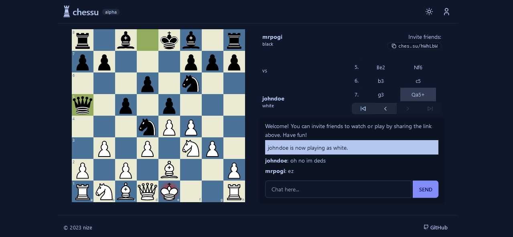

# chessu

> 项目地址：https://github.com/rick-peng-li/chessu-web

chessu 是一个在线国际象棋对弈 Web 应用，支持多名玩家实时对弈、观战与聊天，并提供账号系统记录战绩与对局历史，界面适配移动端。



## 功能特性

- 实时对弈：玩家之间通过 WebSocket 实时走子，服务端使用 chess.js 校验每一步合法性
- 观战与聊天：任意对局可进入观战，房间内支持实时聊天
- 对局管理：创建对局（选择白方/黑方/随机）、公开对局列表、邀请码加入、私密对局
- 账号系统：注册、登录、游客模式、资料修改；自动统计胜/负/和场次
- 对局回顾：已结束的对局按 PGN 记录存档，可逐步回放
- 主题切换：明/暗主题，跟随系统偏好
- 断线处理：玩家断线后可重连，超时可认输或判和

## 技术栈与架构

| 层级 | 技术 |
| --- | --- |
| 前端 | Next.js 14（App Router）、React 18、TypeScript、Tailwind CSS + daisyUI、react-chessboard、socket.io-client |
| 后端 | Node.js 20、Express.js、TypeScript、Socket.IO、chess.js、express-session + connect-pg-simple、argon2、xss |
| 数据库 | PostgreSQL（用户、对局、会话存储） |
| 工程化 | pnpm workspaces monorepo、ESLint、Prettier、Docker / docker-compose |

架构采用前后端分离的三包 monorepo 结构：

```
chessu-web
├── client/              # Next.js 前端应用（默认端口 3000）
│   └── src/
│       ├── app/         # App Router 路由入口（薄壳，负责 metadata 与页面挂载）
│       ├── pages/       # 页面组件（按模块分文件夹：home/auth/games/leaderboard/...）
│       ├── router/      # 路由配置（ROUTES 常量、导航菜单、NavLink 组件）
│       ├── components/  # 组件（common 公共组件 + 按模块拆分的子文件夹）
│       ├── lib/         # 后端 API 调用层
│       ├── utils/       # 公共方法（日期格式化、胜率计算、剪贴板等）
│       ├── context/     # 全局会话 Context
│       └── types.ts     # 前端专用类型
├── server/              # Express + Socket.IO 后端服务（默认端口 3001）
│   └── src/
│       ├── controllers/ # 控制器（auth/games/users/stats）
│       ├── routes/      # 路由注册
│       ├── models/      # 数据库模型（user/game）
│       ├── socket/      # Socket.IO 事件处理
│       └── middleware/  # 会话中间件
├── types/               # 前后端共享的 TypeScript 类型定义（@chessu/types）
├── assets/              # 项目图片资源
├── docker-compose.yml
└── Dockerfile
```

- 前端通过 REST 接口完成会话、对局查询与创建，通过 Socket.IO 完成走子、聊天、观战等实时通信。
- 后端将对局状态保存在内存（`activeGames`）中实时同步，对局结束后写入 PostgreSQL 存档并更新战绩。
- 会话基于 Cookie + express-session，会话数据持久化到 PostgreSQL，Socket.IO 连接复用同一会话鉴权。

## 页面功能

| 路由 | 页面 | 功能 |
| --- | --- | --- |
| `/` | 大厅首页 | 浏览公开对局列表并刷新、通过邀请码加入对局、创建新对局（选边/随机/私密） |
| `/{code}` | 对局页 | 实时走子（拖拽/点选）、观战、房间聊天、认输/求和、断线重连、终局提示 |
| `/games` | 对局中心 | 浏览进行中的公开对局与已结束对局历史，支持按玩家/邀请码搜索 |
| `/leaderboard` | 排行榜 | 注册玩家按胜场排名，支持搜索与按胜场/场次/胜率排序 |
| `/players` | 在线玩家 | 展示当前连接到对局的玩家与观战者，可一键进入观战 |
| `/stats` | 平台统计 | 注册人数、对局总数、进行中对局、和棋数与胜负分布可视化 |
| `/login` | 登录页 | 独立登录页面，支持账号登录与游客进入 |
| `/register` | 注册页 | 独立注册页面，注册后自动登录 |
| `/user/{name}` | 用户主页 | 查看用户胜/负/和统计与最近对局列表，一键复制主页链接 |
| `/archive/{id}` | 对局回顾 | 基于存档 PGN 逐步回放整局棋 |
| `/settings` | 账号设置 | 修改用户名、邮箱、密码（需登录） |
| `/help` | 帮助中心 | 上手指南、行棋规则、游戏模式介绍与常见问题 |
| `/about` | 关于 | 项目介绍、技术栈与相关链接 |

页头右侧为用户入口：未登录时点击跳转登录页，已登录时展开账号菜单（主页/设置/退出）。

## 接口设计

### REST API（前缀 `/v1`，服务端端口 3001）

| 方法 | 路径 | 说明 |
| --- | --- | --- |
| GET | `/v1/auth` | 获取当前登录会话用户 |
| POST | `/v1/auth/guest` | 创建/更新游客会话 |
| POST | `/v1/auth/register` | 注册账号（用户名唯一，密码 argon2 加密） |
| POST | `/v1/auth/login` | 登录（支持用户名或邮箱） |
| POST | `/v1/auth/logout` | 退出登录，销毁会话 |
| PATCH | `/v1/auth` | 修改用户名/邮箱/密码 |
| GET | `/v1/games` | 获取所有进行中的公开对局 |
| GET | `/v1/games?{id \| userid}` | 按 id 获取单场存档对局，或按用户 id 获取其历史对局 |
| GET | `/v1/games/{code}` | 按邀请码获取进行中的对局 |
| GET | `/v1/games/history` | 获取最近已结束的对局列表（支持 limit 参数） |
| POST | `/v1/games` | 创建对局（指定执白/执黑/随机、是否私密） |
| GET | `/v1/users` | 获取注册用户列表（按胜场排序，排行榜数据源） |
| GET | `/v1/users/online` | 获取当前在线的玩家与观战者 |
| GET | `/v1/users/{name}` | 获取用户资料及最近对局 |
| GET | `/v1/stats` | 获取平台统计数据（用户数、对局数、胜负和分布等） |

### Socket.IO 事件

| 事件 | 方向 | 说明 |
| --- | --- | --- |
| `joinLobby` / `leaveLobby` | 客户端 → 服务端 | 加入/离开对局房间（玩家或观战者） |
| `joinAsPlayer` | 客户端 → 服务端 | 观战者转为玩家（补位空缺一方） |
| `getLatestGame` / `receivedLatestGame` | 双向 | 请求/同步最新对局状态 |
| `sendMove` / `receivedMove` | 双向 | 发送/广播走子，服务端校验合法性 |
| `chat` | 双向 | 房间内实时聊天 |
| `claimAbandoned` | 客户端 → 服务端 | 对手断线超时后认赢/判和 |
| `gameOver` | 服务端 → 客户端 | 广播对局结束（原因、胜方、存档 id） |
| `userJoinedAsPlayer` | 服务端 → 客户端 | 广播有观战者成为玩家 |

## 本地开发

> 需要 Node.js 20+ 与 pnpm，以及一个 PostgreSQL 数据库。

1. 安装依赖（在项目根目录执行）：

   ```sh
   pnpm install
   ```

2. 配置数据库：复制 `server/.env.example` 为 `server/.env`，填入 PostgreSQL 连接信息：

   ```env
   PGHOST=localhost
   PGPORT=5432
   PGUSER=exampleuser
   PGPASSWORD=examplepassword
   PGDATABASE=chessu
   ```

   可用 Docker 快速启动一个 PostgreSQL：

   ```sh
   docker run -d --name chessu-postgres -p 5432:5432 \
     -e POSTGRES_DB=chessu \
     -e POSTGRES_USER=exampleuser \
     -e POSTGRES_PASSWORD=examplepassword \
     postgres:15
   ```

3. 启动前后端开发服务：

   ```sh
   pnpm dev           # 同时启动前端与后端
   pnpm dev:client    # 仅启动前端
   pnpm dev:server    # 仅启动后端
   ```

4. 访问前端 http://localhost:3000，后端接口 http://localhost:3001。

   - 首次启动会自动建表（`user`、`game`），无需手动迁移。
   - 在页面右上角头像弹窗中注册账号即可登录；游客模式无需注册即可创建/加入对局。

## Docker 部署

构建镜像：

```sh
docker build -t chessu .
```

运行容器（同时启动 PostgreSQL）：

```sh
docker-compose up
```

- 应用访问地址：http://localhost:3000，接口：http://localhost:3001。
- 请保证 `server/.env` 与 `docker-compose.yml` 中的数据库配置一致。

## 许可证

[MIT](./LICENSE)
